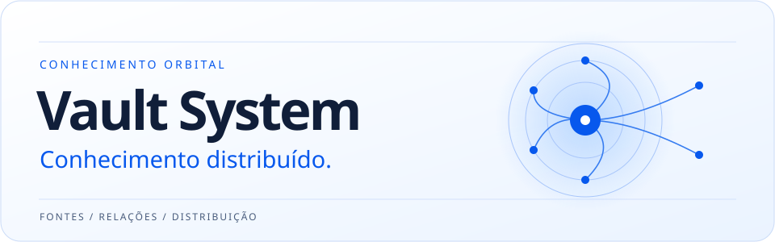

  

<h1 align="center">Vault System</h1>

<strong>Conhecimento distribuído para pessoas, agentes e ferramentas.</strong>

<a href="#como-funciona">Como funciona</a> · <a href="#estado-do-projeto">Estado do projeto</a>

Vault System reúne conhecimento que vive espalhado entre código, documentação e decisões de projeto. Ele relaciona essas informações com suas fontes e ajuda a levar o contexto certo para pessoas, agentes e ferramentas.

## Como funciona

| Etapa | O que acontece |
| --- | --- |
| **01 · Reunir** | Código, documentos e decisões entram na órbita do projeto. |
| **02 · Conectar** | As relações entre as fontes dão contexto a cada informação. |
| **03 · Distribuir** | Pessoas, agentes e ferramentas reaproveitam esse contexto onde trabalham. |

## Estado do projeto

Este repositório está em preparação.

A próxima etapa é incorporar a versão mais recente da base, revisar o fluxo de inicialização da CLI e trazer o planejamento do arquivo de lock. A documentação de instalação acompanha a primeira versão executável.
